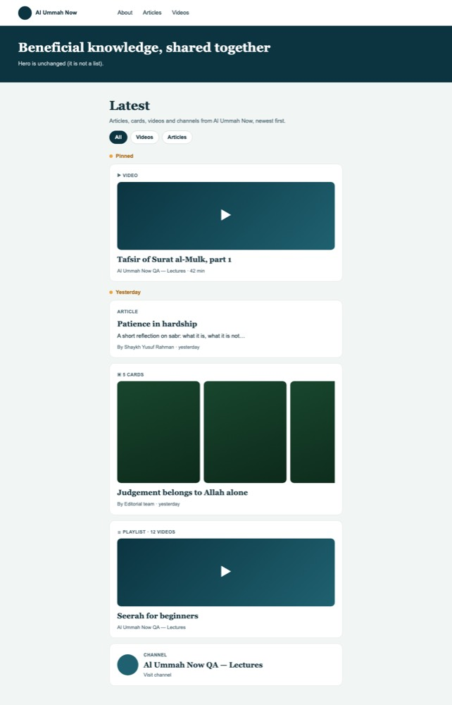
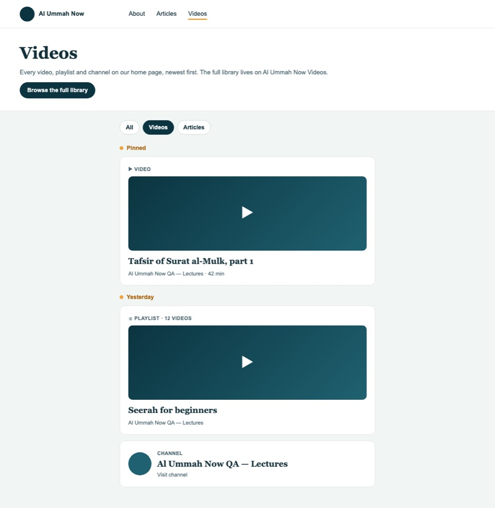
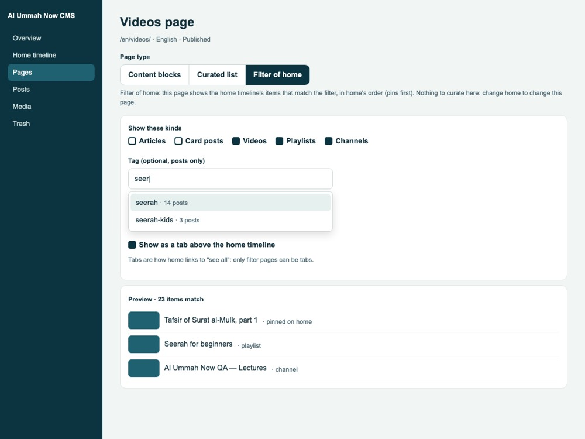

# www pages: one list, curated pages and filter pages

Status: **draft, for owner approval** (2026-11-11). Covers the CMS (this repo) and www (AlUmmahNowUI).

The owner's rule (2026-11-11):

> why videos and posts are two types, its one list on main page with a list of posts that can be posts,
> cards, whatever, videos, as for having multiple pages, its either a separate manually curated page, same
> as main, or its auto from main field with a filter, like type videos

## 1. Today, and what is wrong

| Where | What it shows | Curated in |
|---|---|---|
| www home, "Chosen for you" rail | `curated_videos` with placement `home` | Site screen, Home videos |
| www home, "Latest" timeline | the KV feed: posts (auto) and video entries | Timeline screen |
| www home, "All featured videos" link | goes to `/videos` | (the link) |
| www `/videos`, "Featured videos" | `curated_videos` with placement `videos`, a **different list** | Site screen, Videos page |
| www `/articles` | every live main-site post, numbered pages | nowhere (automatic) |
| CMS `/home` API `posts` (3 latest) | not shown by www any more ("Latest articles" was replaced by the timeline) | |

So "All featured videos" on home points at a separately curated list. Videos can be on home in two
places (the rail, and the timeline) with two different editors.

Data today (read-only queries, 2026-11-11):

| Env | `curated_videos` | timeline video entries | posts switched off home |
|---|---|---|---|
| QA | home: 3 videos; videos: 2 videos + 1 channel (all `all`, published) | 0 | 0 |
| stage | none | 0 | 0 |
| prod | home: 2 videos (published); videos: 1 video (draft) | 0 | 0 |

Before (QA, 2026-11-11). The home rail is not shown on QA because its 3 videos no longer resolve; `/videos`
shows only the channel for the same reason:

| Home (en) | /videos (en) |
|---|---|
|  |  |

## 2. The model

1. **Home is one ordered timeline of mixed items.** Item kinds: article, card post, video, playlist,
   **channel** (new on the timeline). Each kind keeps its own card. Pinned items first, then newest first,
   exactly as today (docs/FEED.md). No separate shelves.
2. **Every other list page is one of two kinds.**
   - **Curated:** its own timeline, edited with the same screen and the same mechanics as home: add a post
     or a video, pin and drag pins, hide, set the timeline date, remove.
   - **Filter:** a view of home's list. It shows home's items that match the filter, in home's order
     (pins included). There is nothing to curate: change home and the page changes.
     Filters: **kind** (any of article, cards, video, playlist, channel) and, optionally, **one tag**
     (posts only, so a tag filter matches posts only).
3. **Content pages stay.** About and other block pages keep their blocks. The page editor picks the type:
   *Content blocks*, *Curated list* or *Filter of home*.
4. **"See all" only goes to a filter page of the same list.** Decision **D1** below: home has no sections,
   so it has no "see all" links. Above the timeline it shows **tabs**. Each tab is a filter page with
   "Show as a tab on home" turned on, plus *All* (home itself). Only filter pages can be tabs, so the
   rule holds by construction.

### Decisions

| # | Decision | Why |
|---|---|---|
| D1 | **Home is a single stream with tabs** (All · Videos · Articles). The "Chosen for you" rail, "All featured videos" and the "All articles" link go. The hero stays: it is not a list. | The owner's "one list". The tabs are the only "see all" links, and they always open a filter of this list. |
| D2 | `/videos` becomes **Filter of home: video, playlist, channel**, a tab. | The owner's example. |
| D3 | `/articles` becomes **Filter of home: article, cards**, a tab. | The same rule. Today it lists every live main-site post. The difference is posts switched off home: there are 0 in every env, so nothing visible changes. From now on, a post switched off home also leaves `/articles`. It stays at its own address, in search, in the sitemap and on its scholar page. |
| D4 | Home's feed stays in Workers KV, unchanged. Other list pages are served by the public API from D1 (`GET /api/public/v1/lists/:slug`), through www's usual cache → CMS → snapshot chain with a 60 s edge cache, the same as `/articles` today. | A filter page has to use exactly home's membership rule. In D1 it is the same SQL, so it can never drift. Per-list KV feeds would multiply the build's writes and complexity for pages with a fraction of home's traffic. Revisit only if a list page gets heavy traffic. |
| D5 | Scholar pages stay as designed (docs/SCHOLARS.md). | A scholar page lists **everything** the scholar publishes. "Filter of home by scholar" would show only what editors featured, which is a different list. If editors want a "Featured from Shaykh X" page, it is a later, cheap filter (`author_sub`). Not in v1. |
| D6 | Block pages keep their `videos` shelf and `posts` blocks. | They are content inside an article-like page, not pages of their own. The only content page in any env today is About. A later "excerpt of a list" block could replace them; not in v1. |
| D7 | Channels join the timeline as an item kind (`video_kind = 'channel'`). | QA's `/videos` has a channel. Without this kind, the merge would drop it. |

## 3. After

| Home (en) | /videos (en): filter of home |
|---|---|
|  |  |

These are mockups; the real cards are the existing `FeedCard` layouts. In Arabic the tabs read
الكل · الفيديو · المقالات, right to left.

## 4. Data model (CMS)

Migration `0016_www_pages.sql`. It is expand-only: nothing is dropped, and `curated_videos` is kept read-only.

```sql
-- pages: what kind of page it is
alter table pages add column list_kind text;     -- NULL = content blocks | 'curated' | 'filter'
alter table pages add column list_filter text;   -- JSON {"kinds":["video","playlist","channel"],"tag":null}
alter table pages add column home_tab integer;   -- 1 = shown as a tab above the home timeline (filter pages only)
alter table pages add column tab_sort integer;   -- tab order

-- a curated page's entries: timeline_entries' shape, one page each (the page has one locale)
create table page_entries (
  id integer primary key autoincrement,
  page_id integer not null,
  kind text not null,            -- 'post' | 'video'
  post_id integer, video_kind text, ref_id text,  -- video_kind: video | playlist | channel
  entry_date text, title_override text,
  hidden integer not null default 0, pin_rank integer,
  deleted_at text, deleted_by text,               -- soft delete (docs/SOFT_DELETE.md)
  created_at text not null, created_by text, updated_at text not null, updated_by text
);
create unique index idx_page_entries_post  on page_entries (page_id, post_id) where kind = 'post' and deleted_at is null;
create unique index idx_page_entries_video on page_entries (page_id, video_kind, ref_id) where kind = 'video' and deleted_at is null;
```

- **Home** is not a `pages` row. It stays `timeline_entries` plus automatic posts: the reserved slug
  `home`, edited on the Timeline screen, now called **Home**.
- **Curated pages hold only what was added.** Posts do not join them automatically. Order is the same
  as home: pins by rank, then entry date (default: the post's `published_at`, the video's upload date).
  Editors can change the date.
- **Filter pages** have no entries. `list_filter.kinds` is required and non-empty. `tag` is optional.
- **Feed item shape:** `FeedVideo.kind` gains `'channel'` (`snapshot` carries the channel's name, handle
  and avatar). This changes the stored shape, so it **bumps `FEED_FORMAT`** (docs/FEED.md "Format
  version"), and every env's feed rebuilds on its own after deploy.
- **Public API:** `GET /api/public/v1/lists/:slug?locale&before|page` returns
  `{ page: {title, summary, list_kind, list_filter}, pinned, items, next }`. Items are the feed's
  `FeedItem` shape, so www renders them with the same `Timeline` component. `GET /site` adds `tabs`
  (`[{slug, title}]`, by `tab_sort`) for home. `/videos` and `/home.videos` keep answering for www
  versions that are still deployed; see the migration plan.

## 5. The CMS editor



- **Pages list:** a *Type* column (Content, Curated list, Filter of home). **New page** asks for the
  type first, in an in-app dialog with three choices.
- **Page type** is a segmented control in the page editor. Switching does not lose data:
  - curated → filter soft-deletes the entries, and switching back offers to restore them;
  - content → list keeps the blocks.
  The switch confirms in the in-app dialog (never a browser prompt).
- **Curated list:** the Timeline screen's component, scoped to the page.
  - **Add a post** is a live autocomplete over the page language's published posts, title and slug
    (the shared combobox; no raw ids).
  - **Add a video** is the video picker with Video, Playlist and **Channel**.
  - Pin, drag pins (and Move up / Move down, Alt+↑/↓), hide, timeline date, title on the site.
  - **Remove** shows an undo toast. The entry goes to Recently deleted for 30 days, and an admin can
    delete it for good there.
  - Every change goes to the page's change log (who, when, before → after).
- **Filter of home:**
  - kind checkboxes;
  - **Tag** as a live autocomplete over the tags in use, with post counts;
  - **Show as a tab on home**, with tab order set by drag on the Home screen;
  - a live **preview** of the first 10 matching items and the match count.

  There is nothing else to edit.
- **Home** (the Timeline screen) also gets **Add a video → Channel**, and a *Tabs* card that lists the
  tab pages, in their order.
- **Site screen:** the *Home videos* and *Videos page* sections are replaced by a note: "Videos are now
  on the Home timeline. /videos is a filter of it." with links to both.
- **Deleting a page** is the existing soft delete (Recently deleted, 30 days). A deleted tab page leaves
  the tabs at once.
- **Languages:** every string in en and ar, RTL in Arabic. Pages are per locale, as today. *Add
  translation* copies the type, the filter and the tab setting. For curated pages it copies only the
  entries whose posts have a translation, plus every video entry.
- **Slugs:** `home` is reserved, as today. `videos` and `articles` are ordinary filter pages: editors can
  rename their title and intro, but not change the slug.

## 6. www

- `src/pages/[locale]/index.astro`: no rail. Tabs from `/site` tabs above the timeline. Remove
  `home.curatedTitle` / `home.curatedAll` and `timeline.allArticles` (en/ar).
- `videos.astro` and `articles/index.astro` render the list page `videos` / `articles` through a shared
  `ListPage` component: page head, tabs, then `Timeline`. The *Browse the full library* button stays
  on `/videos`.
- `[slug].astro`: a page with `list_kind` renders `ListPage`; a content page renders as today.
- **URLs:** `/en|ar/videos/`, `/en|ar/articles/` and `/en|ar/articles/?page=N` keep working (`?page=N` is
  served by offset, `rel=next` now uses `?before=`). Article URLs do not change. A slug that was a content
  page and becomes a list keeps its URL.
- **Fallback:** if the CMS is unreachable, a list page uses the snapshot and then built-in content
  (videos: the empty state with *Browse the full library*). It never fails.
- `src/lib/feed.ts`: `FeedVideo.kind` gains `'channel'`, rendered as the channel card from today's
  `/videos`. The reader must ship **before** the CMS publishes channel items.

## 7. Migration

The SQL is in migration 0016 (§4) and runs once per env:

1. **Merge the curated videos into the home timeline**, in this precedence:
   1. existing timeline entries win: a video that is already on the timeline is kept as it is;
   2. then `curated_videos` placement `home`;
   3. then placement `videos`, so `/videos` (now a filter) still shows them.

   Rules:
   - Only `published` rows move. Drafts stay in `curated_videos` (prod has one), untouched.
   - Locale: `all` stays `all`. A `curated_videos` row for `all` that overlaps a timeline entry for one
     locale adds only the other locale.
   - Date: the curated row's `created_at`, when an editor chose it. Editors can move it on Home.
   - `created_by` is `system/migration-0016`, and each move is logged in `timeline_changes`
     (action `add`).
   - Snapshots: a missing `video_snapshots` row is copied from `curated_videos.snapshot`. The cron
     refreshes it, and an unavailable video is left out of the feed as today. QA's 3 home videos do
     not resolve now, so they will show as *Not public on the videos site* on the Home screen.
   - Articles need nothing: every live main-site post is already on the timeline by date.
2. **Seed the pages:** `videos` and `articles` in en and ar, `list_kind = 'filter'`, kinds as in D2/D3,
   `home_tab = 1`. Titles and intros come from the current www strings (`videos.title` / `articles.title`).
3. **Rebuild:** the `FEED_FORMAT` bump (channel kind) rebuilds every env's feed automatically:
   - the QA deploy and release steps run `scripts/release/feed-format.ts`;
   - the lazy cron is the safety net.
   - The migration also inserts `all` into `feed_dirty`, so the new video entries are built even before
     the format check.
   - Never press the rebuild button for this.
4. **Deploy order**, to avoid deploy skew:
   1. **www** first: it reads channel items and uses `/lists` when present. Until then it falls back to
      today's pages.
   2. Then the **CMS** with migration 0016. From this release, `/home.videos` returns `[]`, so an older
      www shows no rail and no duplicate. `/videos?placement=…` keeps returning the old rows for one
      release, then returns `[]`.

### QA and stage

QA runs on merge (`deploy-qa.yml`: migrations, then `feed-format.ts`). Stage runs in the release
pipeline. Checks per env:

- `X-Feed-Source: feed` on `/en/`;
- the home head's `format` equals `FEED_FORMAT`;
- `/en/videos/` lists QA's channel and videos;
- `/en/articles/?page=2` still answers;
- the tabs show on `/en/` and `/ar/`.

### Production steps

1. Merge the www PR, then the CMS PR. `release.yml` runs:
   - stage promote, then stage migrations and `feed-format.ts`;
   - production promote, then `wrangler d1 migrations apply DB --remote --env=""`;
   - `feed-format.ts`, which waits until both heads and D1 carry the new format (it fails after 15 min);
   - `queue-consumers.ts`.
2. Verify (read-only):
   - `curl -sI https://www.alummahnow.net/en/ | grep -i x-feed-source` → `feed`;
   - `/en/videos/` and `/ar/videos/` show the 2 home videos (prod's draft stays out);
   - `/en/articles/` lists the same posts as before;
   - the Home screen's Recent changes shows `system/release` rebuild and `system/migration-0016` adds.
3. **Rollback:**
   - The CMS rollback keeps the data, because the migration is expand-only. Old code ignores the new
     columns and tables.
   - The rolled-back code's lower `FEED_FORMAT` makes the lazy check rebuild in the old format, which has
     no channel items. Do not roll www back below the channel reader while the CMS is on 0016.
   - `curated_videos` is untouched, so the old screens still work.

## 8. Tests (no paid AI anywhere; none of this calls an AI provider)

- **CMS worker:**
  - the migration merge: precedence, locale overlap, drafts left, idempotent;
  - `/lists`: a filter equals home's list filtered (pins, hidden, switched-off, scholar not featured);
  - curated page CRUD, soft delete and restore;
  - tabs;
  - the type switch;
  - `FEED_FORMAT` fingerprint.
- **CMS E2E:** create a filter page and a curated page in en and ar, with autocomplete pickers, the
  undo toast and the in-app dialogs.
- **www:**
  - unit tests for channel items and `?page=` offsets;
  - E2E: home tabs → `/videos` shows only videos, in home's order;
  - E2E: `/articles/?page=2`;
  - an RTL snapshot.

## 9. Out of scope / follow-ups

- "Featured from a scholar" filter pages (`author_sub`), D5.
- Replacing block-page shelves with a list-excerpt block, D6.
- Per-list KV feeds, if a list page's traffic ever warrants it, D4.
