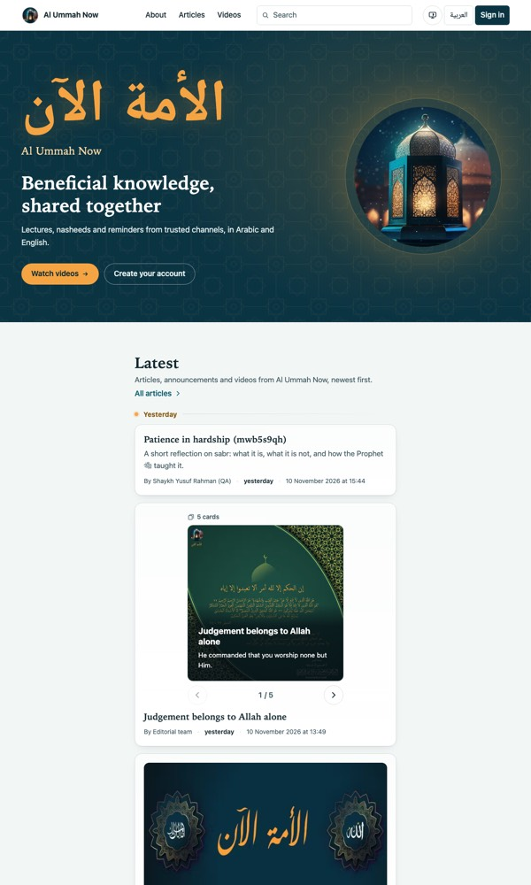
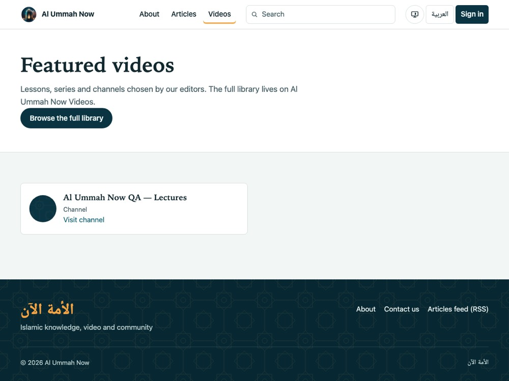

# www pages: one list, curated pages and filter pages

Status: **approved by the owner** (2026-11-11, decisions D1–D7 below, D1–D3 as changed by the owner). Covers the CMS (this repo) and www (AlUmmahNowUI).

The owner's rule (2026-11-11):

> why videos and posts are two types, its one list on main page with a list of posts that can be posts,
> cards, whatever, videos, as for having multiple pages, its either a separate manually curated page, same
> as main, or its auto from main field with a filter, like type videos

## 1. Today, and what is wrong

| Where | What it shows | Curated in |
|---|---|---|
| www home, "Chosen for you" rail | `curated_videos` with placement `home` | Site screen, Home videos |
| www home, "Latest" timeline | the KV feed: posts (auto) and video entries | Timeline screen |
| www home, "All featured videos" link | goes to `/videos` | (the link) |
| www `/videos`, "Featured videos" | `curated_videos` with placement `videos`, a **different list** | Site screen, Videos page |
| www `/articles` | every live main-site post, numbered pages | nowhere (automatic) |
| CMS `/home` API `posts` (3 latest) | not shown by www any more ("Latest articles" was replaced by the timeline) | |

So "All featured videos" on home points at a separately curated list. Videos can be on home in two
places (the rail, and the timeline) with two different editors.

Data today (read-only queries, 2026-11-11):

| Env | `curated_videos` | timeline video entries | posts switched off home |
|---|---|---|---|
| QA | home: 3 videos; videos: 2 videos + 1 channel (all `all`, published) | 0 | 0 |
| stage | none | 0 | 0 |
| prod | home: 2 videos (published); videos: 1 video (draft) | 0 | 0 |

Before (QA, 2026-11-11). The home rail is not shown on QA because its 3 videos no longer resolve; `/videos`
shows only the channel for the same reason:

| Home (en) | /videos (en) |
|---|---|
|  |  |

QA's 5 dead rows (3 home, 2 `/videos`) are videos the QA videos site no longer has. The videos API answers
404 for them, and their stored snapshot says `public: false`. Production's 2 home rows and 1 draft are
all public.

## 2. The model

1. **Home is one ordered timeline of mixed items, with nothing else around it but the hero.** Item kinds:
   - article;
   - card post;
   - video;
   - playlist;
   - **channel**, new (D7).

   Each kind keeps its own card. Order: pinned first, then newest first, exactly as today (docs/FEED.md).
   - No shelves and no tabs.
   - No "Chosen for you", "All featured videos" or "All articles".
   - Videos and Articles are reached from the site menu only.
2. **Every www page is one of three kinds** (D6), and the page editor picks the kind:
   - **Content page:** blocks, as today (About).
   - **Curated list:** its own timeline. It uses the same editor and the same mechanics as home: add a post
     or a video, pin and drag pins, hide, set the timeline date, remove.
   - **Filter:** everything **published in the CMS** of the chosen kinds. Home's list does not limit it.
     - Kinds: any of article, cards, video, playlist, channel.
     - Tag: optional, and it matches posts only.
     - There is nothing to curate.
3. **What "published in the CMS" means for each kind:**
   - **Posts:** every live main-site post: published, `publish_at` passed, staff or featured scholar
     (docs/SCHOLARS.md). This is today's `/articles`.
   - **Videos, playlists and channels:** every one an editor has **added in the CMS**, on any list. That
     covers the home timeline, any curated page, and the CMS's **Videos** screen. They are kept in one
     de-duplicated **video library** (`cms_videos`). Taking an item off home or off a curated page leaves
     it in the library.
   - **It leaves the library** when:
     - it is soft-deleted on the Videos screen (Recently deleted, 30 days); or
     - the videos site stops serving it as public. It comes back if it is public again.
   - The library is **not** a mirror of the public videos library, which stays on Al Ummah Now Videos.
4. **Filter order:**
   - newest first;
   - posts by `published_at`;
   - videos by **when they were first added** to the library.

## 3. Decisions

| # | Decision |
|---|---|
| D1 | **Home is one list with no tabs.** Remove the "Chosen for you" rail, "All featured videos" and "All articles". The hero stays. |
| D2 | `/videos` is a **Filter** page (video, playlist, channel). It lists the CMS video library, newest added first, de-duplicated. The *Browse the full library* button stays. |
| D3 | `/articles` is a **Filter** page (article, cards): every published article and card post. That is today's set, so `?page=N` URLs keep working. |
| D4 | Home stays in Workers KV, unchanged. Every other list page comes from D1 through the public API (`GET /api/public/v1/lists/:slug`, `s-maxage=60`), through www's usual cache → CMS → snapshot → built-in chain. |
| D5 | Scholar pages are unchanged: they show everything the scholar published. |
| D6 | Three page kinds: Content page, Curated list, Filter. |
| D7 | Channels are a timeline item kind. The card shows the name, the avatar and the 3 latest videos. The channel snapshot gains `latest` (from `GET /api/channels/:id/videos`), and **`FEED_FORMAT` is bumped**. |

## 4. Data model (CMS), migration `0016_www_pages.sql`

The migration is expand-only. `curated_videos` is no longer read or written by the admin, and the public
`/videos` and `/home.videos` endpoints serve `[]` once www stops calling them (§7).

```sql
alter table pages add column list_kind text;    -- NULL = content page | 'curated' | 'filter'
alter table pages add column list_filter text;  -- filter: JSON {"kinds":["video","playlist","channel"],"tag":null}

-- the CMS video library: every video / playlist / channel an editor added, once
create table cms_videos (
  id integer primary key autoincrement,
  kind text not null,               -- video | playlist | channel
  ref_id text not null,
  locale text not null,             -- 'all' | 'en' | 'ar' (added for one language on every list → that language)
  added_at text not null,           -- first added: the filter order
  added_by text, added_from text,   -- 'home' | 'page:<id>' | 'library' | 'migration-0016'
  created_at text not null, updated_at text not null
);
create unique index idx_cms_videos_ref on cms_videos (kind, ref_id);

-- a curated page's entries (timeline_entries' shape; the page has one locale)
create table page_entries (
  id integer primary key autoincrement,
  page_id integer not null,
  kind text not null,               -- 'post' | 'video'
  post_id integer, video_kind text, ref_id text,
  entry_date text, title_override text,
  hidden integer not null default 0, pin_rank integer,
  created_at text not null, created_by text, updated_at text not null, updated_by text
);
```

- **Soft delete.** It reuses `trash` (docs/SOFT_DELETE.md). Two new kinds, `cms_videos` and
  `page_entries`, can be restored for 30 days.
  - Removing a video entry from home or from a curated page soft-deletes the entry only. The library
    keeps the video.
  - Deleting a curated page soft-deletes the page. Its entries stay, and come back with it.
- **Home** keeps `timeline_entries`. Adding a video on home also adds it to the library. `addVideo`
  accepts `channel`.
- **Channel snapshot:** `{ title, handle, thumbnail_url, public, latest: [{id, title, thumbnail_url, duration}] }`,
  with at most 3 entries in `latest`. It is refreshed by the existing snapshot cron. `FeedVideo.kind`
  gains `'channel'`, which bumps **`FEED_FORMAT`**.
- **Public API:** `GET /api/public/v1/lists/:slug?locale&page`. It answers
  `{ page: {slug, locale, title, summary, list_kind, list_filter, alternates}, pinned, items, page, pages, total }`.
  - Items use the feed's `FeedItem` shape, so www renders them with the home `Timeline` card components.
  - Paging is by page number, 20 per page.
  - Curated pages put pinned items on page 1.
  - A content page answers 404 there and keeps using `/pages/:slug`.
  - `/pages/:slug` adds `list_kind`, so www knows which route to render.

## 5. The CMS editor

- **Pages:**
  - The list gets a *Type* column.
  - **New page** asks for the type in an in-app dialog.
  - The editor shows **Page type** as a segmented control. Switching type confirms in the in-app dialog
    and keeps the other kind's data: blocks and entries stay, so switching back restores them.
- **Curated list editor:** the Timeline screen's component, scoped to the page.
  - **Add a post:** live autocomplete over the page language's published posts. It opens with the newest
    posts already listed, before anything is typed.
  - **Add a video:** the video picker with Video, Playlist and Channel. It opens with content, following
    the pickers work in CMS #90.
  - Pin, drag pins (and Move up / Move down, Alt+↑/↓), hide, timeline date, title on the site.
  - **Remove:** moves the entry to Recently deleted, with a toast.
- **Filter editor:**
  - kind checkboxes;
  - **Tag**, a live autocomplete over the tags in use. It opens with the most used tags;
  - a live **preview** of the first 10 items and the total.
- **Videos screen** (new, under Content). It lists the library, newest added first, with: thumbnail,
  title, kind, language, added (who and when), where it is used (Home, page names), and *Not public on
  the videos site*.
  - **Add a video:** the picker. The video goes on `/videos` without being on home.
  - **Language:** All, English or Arabic.
  - **Delete:** the in-app confirm dialog with a reason. The video goes to Recently deleted and leaves
    `/videos` (and every filter page). Home and curated pages keep their entries: they are edited on
    their own screens. (Changed while building: this keeps the KV feed independent of the library, and
    it is exactly the owner's rule, "unpublishing or soft-deleting removes it from these pages".)
- **Home** (the Timeline screen): **Add a video** also offers Channel.
- **The old curated screen** (`/videos?placement=home|videos`) is replaced by the Videos screen at the
  same address and menu entry. The picker's curated-row API stays for www releases still reading it.
- **en/ar:** every string, RTL in Arabic. *Add translation* copies the type and the filter; a curated
  page's translation starts with an empty list (its posts are other posts).

## 6. www

- **Home:** the hero, then the timeline. The rail and the two "all …" links are removed, and so are the
  strings `home.curatedTitle`, `home.curatedAll` and `timeline.allArticles`.
- **`/videos` and `/articles`:**
  - Both render `ListPage`: the page head, then the `Timeline` cards, then numbered pages.
  - The data comes from `/lists/videos` and `/lists/articles`.
  - If the CMS has no such page, www uses a built-in filter page, so the URLs never 404.
- **`[slug].astro`:** a page whose `list_kind` is set renders `ListPage`. Any other page renders as today.
- **Channel card:** avatar, name and handle, the 3 latest videos as small thumbnails, and *Visit channel*.
- **URLs:** `/en|ar/videos/`, `/en|ar/articles/` and `/en|ar/articles/?page=N` keep working. Article
  URLs do not change.

## 7. Migration

Migration 0017 runs in one batch, per env:

1. **Dead curated rows → Recently deleted.**
   - Which rows: every `curated_videos` row whose snapshot says `public: false`. These are QA's 5. Prod
     has none.
   - How: each row moves into `trash` (kind `curated_videos`) with the reason *Not public on the videos
     site (www pages migration)*, and a `trash_events` row is written for it.
   - Effect: an admin can restore any of them for 30 days.
2. **Orphan timeline rows are purged.**
   - Which rows: `timeline_entries` post rows whose post exists neither in `posts` nor in `trash`. QA has
     126 of them, left by test posts hard-deleted before soft delete existed.
   - Why purge: they are post overrides, not admin items. Rows of trashed posts are kept, so a restored
     post keeps its pin and hidden state.
3. **Fill the library** from published, public `curated_videos` rows and from home's video entries:
   - de-duplicated by (kind, ref_id);
   - language: `all` when the rows disagree;
   - `added_at` is the earliest row.
4. **Home:** published, public `curated_videos` with placement `home` become home timeline entries.
   - An existing timeline entry for the same video wins.
   - `entry_date` is when it was curated, so it sits where editors chose it.
   - The adds are logged in `timeline_changes` by `system/migration-0016`.
   - A missing `video_snapshots` row is copied from the curated snapshot.
   - Drafts are left alone (prod's one draft).
5. **Seed the pages** `videos` and `articles`, in en and ar, as Filter pages.
   - Their titles and intros are today's www strings.
   - A slug that already exists is left as it is.
6. **Rebuild the feed:** the migration marks the feed `all` dirty. The `FEED_FORMAT` bump also triggers the
   automatic full rebuild on QA deploy and on release (`scripts/release/feed-format.ts`). Never press the
   rebuild button for this.

**Deploy order:**
1. **CMS first.** Old www still reads `/home.videos` and `/videos`, and they keep answering until step 2.
   Nothing on home gains a channel until an editor adds one.
2. **www straight after.**
3. **A follow-up CMS PR** makes `/home.videos` and `/videos` return `[]`.

## 8. Production rollout

1. Merge the CMS PR. QA deploys on merge: migrations, then the feed-format rebuild. Check QA:
   - `/en/` shows no rail;
   - `/en/videos/` lists the channel;
   - QA's Recently deleted lists the 5 dead videos;
   - `select count(*) from timeline_entries where kind='post' and post_id not in (select id from posts)`
     is 0.
2. Merge the www PR, which deploys to QA. Check it with the QA E2E run.
3. Run the release (`release.yml`).
   - **Stage:**
     1. promote;
     2. `wrangler d1 migrations apply DB --remote --env stage`;
     3. `feed-format.ts`, which waits for the new format;
     4. `queue-consumers.ts`.
   - **Production:** the same steps with `--env=""`, then the www release.
4. **Verify production** (read-only):
   - `curl -sI https://www.alummahnow.net/en/ | grep -i x-feed-source` → `feed`;
   - `/ar/` shows the 2 Arabic posts and the 2 curated videos in the timeline;
   - `/en/videos/` and `/ar/videos/` list the 2 videos;
   - `/en/articles/` and `/ar/articles/` answer;
   - the CMS Home screen's Recent changes shows `system/migration-0016` adds and a `system/release`
     rebuild.
5. **Rollback:**
   - The CMS rollback leaves the data, because the migration is expand-only. Old code ignores the new
     tables and columns. Its lower `FEED_FORMAT` makes the lazy check rebuild in the old format.
   - Roll back www before the CMS, never the other way round, while channels are on home.

## 9. Tests

None of these tests calls an AI provider.

- **CMS worker:**
  - the migration on fixtures: dead rows go to trash, orphans are purged, trashed posts keep their rows,
    the library is de-duplicated, the home merge's precedence, drafts are left alone, idempotent;
  - `/lists` filter: kinds, tag, unpublished or trashed posts and videos leave, an item taken off home
    stays, newest-added order, paging;
  - curated page entries: add, pin, hide, remove, then restore from trash;
  - the Videos screen: add, language, delete, restore;
  - channel entries on home;
  - the `FEED_FORMAT` fingerprint.
- **www:**
  - unit tests for the `ListPage` data and the channel card;
  - E2E: home has no rail and no tabs;
  - E2E: `/videos` and `/articles` list from `/lists`, including `?page=2`;
  - RTL.
